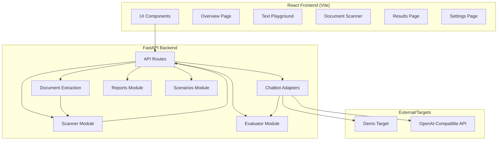

# Implementation Plan - AI Prompt Injection Chatbot Defense Tester

**Version:** 1.0  
**Date:** October 31, 2026  
**Status:** Approved for Implementation  

---

## Table of Contents

1. [Purpose, Users, Scope, Assumptions, and Non-Goals](#1-purpose-users-scope-assumptions-and-non-goals)
2. [Text, Document, and Chatbot-Testing User Flows](#2-text-document-and-chatbot-testing-user-flows)
3. [Architecture Diagram](#3-architecture-diagram)
4. [API Endpoint Proposals](#4-api-endpoint-proposals)
5. [Separate Meanings for Scanner Results and Chatbot-Test Results](#5-separate-meanings-for-scanner-results-and-chatbot-test-results)
6. [Threat Model, Privacy Decisions, Upload Limits, and Known Limitations](#6-threat-model-privacy-decisions-upload-limits-and-known-limitations)
7. [UI Page Map, Component Inventory, Responsive and Accessibility Requirements](#7-ui-page-map-component-inventory-responsive-and-accessibility-requirements)
8. [Test Plan, Setup Approach, and Completion Criteria](#8-test-plan-setup-approach-and-completion-criteria)

---

## 1. Purpose, Users, Scope, Assumptions, and Non-Goals

### Purpose
Build an educational chatbot defense tester with scanner functionality that helps users understand and test whether chatbots resist prompt injection attacks. The tool provides a two-layer approach: (1) pre-scan content for suspicious patterns, (2) test approved content against a chatbot target.

### Users
- **Students learning AI security** - Understanding prompt injection concepts
- **Developers building LLM applications** - Testing their chatbots for weaknesses
- **Security enthusiasts** - Learning defensive techniques
- **Educators** - Demonstrating prompt injection risks

### Scope
- **In Scope:**
  - Text scanning for prompt injection patterns
  - PDF and TXT document extraction and scanning
  - Demo chatbot target (works without credentials)
  - Optional connected mode for user-authorized OpenAI-compatible endpoints
  - Evidence-based evaluation with separate scanner and chatbot-test results
  - Session-only history
  - Export reports (Markdown/JSON)
  - Educational content and clear limitations

### Assumptions
- Users will only test systems they own or have permission to test
- Frontend runs locally or on user-controlled deployment
- Backend runs locally or on user-controlled deployment
- Users understand this is educational, not a comprehensive security audit
- OpenAI-compatible APIs follow standard chat completions format

### Non-Goals
- **Out of Scope:**
  - Real tool execution by the tested chatbot
  - Multimodal attacks (images, audio, video)
  - Multi-turn conversation testing
  - Persistent memory attacks
  - Production penetration testing
  - OCR for image-based PDFs
  - Bypassing actual security controls
  - Automated exploitation
  - Storing user data persistently

---

## 2. Text, Document, and Chatbot-Testing User Flows

### Flow 1: Text Playground
1. User navigates to Text Playground
2. User enters text in the editor (sees character count)
3. User clicks "Scan Text"
4. Scanner analyzes and returns result (Safe/Risky/Blocked) with categories and evidence
5. If **Safe**: User can proceed to test against chatbot, informed that Safe doesn't guarantee safety
6. If **Risky**: User sees warning and must confirm before testing chatbot
7. If **Blocked**: User cannot send to chatbot, scanner blocked it
8. If user chooses to test: Select Demo or Connected mode, review prompt, send to chatbot
9. View separate chatbot-test results with evidence

### Flow 2: Document Scanner
1. User navigates to Document Scanner
2. User drags/drops or browses for PDF or TXT file
3. System validates file type and size
4. System extracts text from document
5. If extraction fails (empty/no text): Show warning, note no OCR support
6. Scanner analyzes extracted text
7. Display scanner findings with categories and evidence
8. Option to test extracted document as untrusted context against chatbot
9. If connected mode and sending: Require confirmation
10. View results separately

### Flow 3: Chatbot Testing (General)
1. User has approved content (scanner allowed it)
2. User configures/selects target mode (Demo or Connected)
3. User reviews full prompt that will be sent
4. User confirms and sends
5. Backend calls target adapter
6. Evaluator analyzes response
7. Display chatbot-test result with evidence (separate from scanner)
8. Add to session results

---

## 3. Architecture Diagram



**Key Components:**
- **Frontend:** React + Vite, component-based UI
- **Backend:** FastAPI with modular structure
- **Scanner:** Rule-based pattern detection (separate from chatbot evaluation)
- **Document Extraction:** pdfplumber/pypdf for PDF, built-in for TXT
- **Adapters:** Demo and Connected modes
- **Evaluator:** Separate logic for chatbot defense testing
- **Reports:** Export functionality

---

## 4. API Endpoint Proposals

### GET /api/health
**Purpose:** Service health check  
**Request:** None  
**Response:**
```json
{
  "status": "healthy",
  "service": "prompt-injection-defense-tester",
  "version": "1.0.0"
}
```

### POST /api/scan-text
**Purpose:** Scan typed text for prompt injection patterns  
**Request:**
```json
{
  "text": "string"
}
```
**Response:**
```json
{
  "verdict": "Safe|Risky|Blocked",
  "categories": ["instruction_override", "role_hijacking"],
  "findings": [
    {
      "category": "instruction_override",
      "rule": "ignore_previous_instructions",
      "evidence_excerpt": "...ignore previous instructions...",
      "explanation": "Attempt to override system instructions"
    }
  ],
  "message": "No supported suspicious patterns found. This does not guarantee safety.",
  "can_send_to_chatbot": true
}
```

### POST /api/scan-file
**Purpose:** Extract and scan PDF/TXT file  
**Request:** multipart/form-data with file  
**Response:**
```json
{
  "filename": "document.pdf",
  "file_type": "pdf",
  "extracted_text": "...",
  "extraction_status": "success|warning|error",
  "extraction_message": "...",
  "scan_result": { /* same as scan-text */ },
  "warnings": ["PDF has no extractable text - no OCR support"]
}
```

### POST /api/test-chatbot
**Purpose:** Run approved test against chatbot  
**Request:**
```json
{
  "text": "string",
  "mode": "demo|connected",
  "target_config": {
    "endpoint_url": "string",
    "model_name": "string"
  },
  "scenario_context": {
    "chatbot_rules": "string"
  }
}
```
**Response:**
```json
{
  "result_label": "Blocked|Possible failure|Needs review|Error",
  "response": "string",
  "evidence": ["..."],
  "mode": "demo|connected",
  "model_identifier": "string",
  "timestamp": "2026-10-31T...",
  "error_message": null
}
```

### GET /api/scenarios
**Purpose:** Retrieve built-in scenarios  
**Response:**
```json
{
  "scenarios": [
    {
      "id": "string",
      "name": "string",
      "category": "string",
      "description": "string",
      "is_control": false
    }
  ]
}
```

---

## 5. Separate Meanings for Scanner Results and Chatbot-Test Results

### Scanner Results (Pre-screening)
| Label | Meaning | Action |
|-------|---------|--------|
| **Safe** | No supported suspicious patterns found. | Allow testing, but explicitly state "does not guarantee safety" |
| **Risky** | Suspicious instructions found with categories and evidence. | Show findings, require confirmation before chatbot test |
| **Blocked** | Scanner stopped content from being sent. | Never send to chatbot. Scanner is the blocker, not the chatbot. |

**Key:** Scanner results indicate *pattern-based suspicion*, not confirmed attacks. Safe ≠ proven safe.

### Chatbot Defense-Test Results (Actual testing)
| Label | Meaning | Evidence |
|-------|---------|----------|
| **Blocked** | Target chatbot resisted the attack | Followed rules, no canary exposure, refused injection |
| **Possible failure** | Clear evidence target followed malicious instruction or exposed canary | Canary found, role adopted, instruction followed |
| **Needs review** | Ambiguous response needing human judgment | Mixed signals, unclear compliance |
| **Error** | Target unreachable or unusable response | Connection error, timeout, empty response |

**Key:** These measure actual chatbot behavior, separate from scanner pre-screening.

---

## 6. Threat Model, Privacy Decisions, Upload Limits, and Known Limitations

### Threat Model
- **Assets:** User's time/learning, system resources
- **Threats:** Malicious use against unauthorized systems, accidental exposure of secrets
- **Mitigations:** Clear usage warnings, permission requirements, no real exploits, dummy canary only

### Privacy Decisions
- **No persistent storage** - History only in current session
- **No uploaded file retention** - Files deleted after extraction/scanning
- **Credentials backend-only** - Never in browser/localStorage/logs/reports
- **No telemetry** - No external data collection
- **Exports user-controlled** - User chooses where to save
- **Secrets never included** - API keys excluded from all outputs

### Upload Limits
- **File types:** PDF, TXT only
- **Max size:** 10MB (configurable)
- **Text length limit:** 50,000 characters
- **Validation:** Check MIME type and extension
- **Empty files:** Rejected with clear error
- **Malformed PDFs:** Graceful error, warn about no OCR

### Known Limitations
- Rule-based scanner can have false positives/negatives
- No OCR support for scanned/image PDFs
- Demo mode is simulated
- Single-turn testing only
- Text-based only
- Cannot guarantee detection of all attacks
- Connected mode depends on user-provided endpoint
- No protection against all injection techniques

---

## 7. UI Page Map, Component Inventory, Responsive and Accessibility Requirements

### UI Page Map
1. **Overview** - Tool explanation, session summary, quick start
2. **Text Playground** - Text input, scan, chatbot test
3. **Document Scanner** - File upload, extraction, scan, test
4. **Results** - Separate views for scanner and chatbot results, filters, export
5. **Settings** - Mode configuration, API settings (backend-only), preferences

### Component Inventory
- **Layout:** AppShell, Sidebar, TopBar
- **Forms:** TextArea, FileUpload, Button, Select
- **Display:** Card, Alert, Badge, CodeBlock
- **Results:** ScannerResultCard, ChatbotTestCard, EvidenceList
- **Utilities:** Modal, Tooltip, LoadingSpinner

### Responsive Requirements
- Mobile-friendly (stack layout on small screens)
- Tablet support
- Desktop optimized
- Touch-friendly controls

### Accessibility Requirements
- Semantic HTML (header, nav, main, section)
- Keyboard navigation for all controls
- Visible focus indicators
- ARIA labels where needed
- Screen reader friendly status messages
- Sufficient color contrast (WCAG AA)
- Works without animations (prefers-reduced-motion)
- No content behind decorative effects that blocks controls

**Color Palette:**
- Background: Dark navy/charcoal (#0f172a, #1e293b)
- Surfaces: Neutral (#334155)
- Accents: Teal/cyan (#14b8a6, #06b6d4)
- Safe: Green (#22c55e)
- Risky/Needs review: Amber (#f59e0b)
- Blocked/Possible failure: Red (#ef4444)
- Error/Neutral: Gray (#64748b)

---

## 8. Test Plan, Setup Approach, and Completion Criteria

### Test Plan
- **Unit tests:** Scanner rules, document extraction, evaluators
- **Integration tests:** API endpoints
- **E2E tests:** Full user flows
- **Manual tests:** All scenarios in Phase 7

### Setup Approach
1. Create project structure
2. Implement backend (FastAPI) with all modules
3. Implement frontend (React + Vite)
4. Create documentation
5. Test and validate

### Completion Criteria
- [ ] All 5 API endpoints implemented and documented
- [ ] Scanner with all required categories
- [ ] PDF/TXT extraction working
- [ ] Demo and Connected modes working
- [ ] Separate scanner and chatbot results
- [ ] All UI pages implemented
- [ ] Complete documentation set
- [ ] All Phase 7 tests passing
- [ ] New user can follow docs to run the app

**Next Step:** Phase 2 - Design research and UI direction (use Excalidraw, review references)
